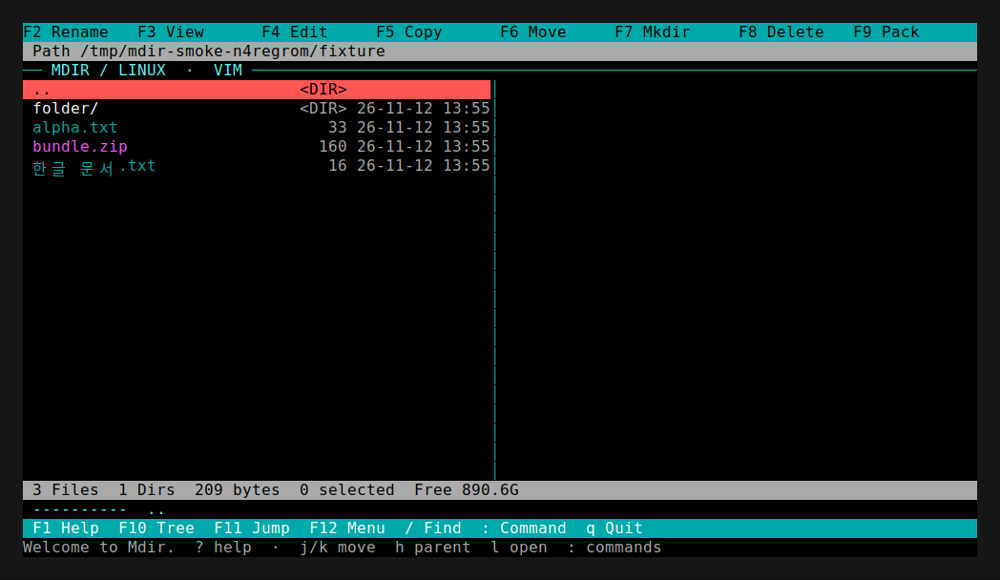

# mdir-fm

A terminal file manager for Linux and macOS inspired by **Korean MDIR III 3.x**, with
Vim navigation and its classic black/cyan file list, red cursor, colored file
types, and blue/yellow directory tree. This is a new Go implementation.

The public command is `mdir-fm`; the source repository is
[`onejae/mdir`](https://github.com/onejae/mdir).



[Directory tree preview](docs/screenshots/tree.png). These previews render a real
PTY capture with disposable example files; glyph appearance depends on your terminal font.

## Run

### Homebrew

The tap is being prepared for publication. Once the tagged release and
[`onejae/homebrew-tap`](https://github.com/onejae/homebrew-tap) are published:

```sh
brew install onejae/tap/mdir
mdir-fm
```

The package is `mdir`; the executable is `mdir-fm`. Homebrew builds the release
from source and installs Go as a build dependency. See the
[publication steps](packaging/homebrew/README.md) for release and tap validation.

### Build from source

The built executable is `bin/mdir-fm`:

```sh
./bin/mdir-fm
./bin/mdir-fm /path/to/directory
```

To build from source, use Go 1.25 or newer:

```sh
make build
./bin/mdir-fm
```

The executable needs a terminal, not redirected input. A UTF-8 terminal at least
32 columns by 10 rows is required; 80×25 or larger is recommended. It resizes
between one and four list columns. Truecolor terminals reproduce the DOS RGB
palette; other color terminals use the nearest supported colors. `NO_COLOR` is
honored. If your shell sets it, `env -u NO_COLOR ./bin/mdir-fm` enables the colors.

`F1` or `?` opens help. `F12` opens the complete command menu. `q` quits.

## Navigation

| Keys | Action |
| --- | --- |
| `j` / `k`, arrows | Next / previous item |
| `h` / `l`, Left / Right | Parent / open directory, archive, or file |
| `Enter` | Open; executable files run in the terminal |
| `gg` / `G` | First / last item |
| `Ctrl-d` / `Ctrl-u` | Half of the visible page down / up |
| `Ctrl-f` / `Ctrl-b`, Page Down / Up | Full page down / up |
| `Tab` / `Shift-Tab` | Next / previous list column |
| `/`, `n`, `N` | Find a filename, next / previous match |
| `Space` / `v` | Toggle selection, with / without advancing |
| `Ctrl-a` / `V` | Select all / invert selection |
| `+` | Select a wildcard pattern |
| `.` | Toggle hidden files |
| `s` | Sort by name, extension, size, date; reverse order |
| `Ctrl-r` | Refresh |
| `~` / `\` | Home directory / filesystem root |
| `Esc` | Cancel prompt/job or clear selection |

Counts work with `j` and `k`, for example `12j`. Prompts accept ordinary text;
`Ctrl-u` clears the field, Home/End and arrows edit it, and Enter accepts it.

## File operations

| Keys | Action |
| --- | --- |
| `c`, `Alt-c`, `F5` | Copy to a destination |
| `m`, `Alt-m`, `F6` | Move to a destination |
| `r`, `Alt-r`, `F2` | Rename current item |
| `x`, Delete, `Alt-d`, `F8` | Permanently delete selected/current items, after confirmation |
| `yy` / `dd` / `p` | Copy / cut to the Mdir clipboard / paste here |
| `Alt-k`, `F7` | Create a directory |
| `F3`, `Alt-v` | View text or hex |
| `e`, `Alt-g`, `F4` | Edit with `VISUAL`, `EDITOR`, `vim`, or `vi` |
| `o` | Execute, or open with `xdg-open` (Linux) / `open` (macOS) |
| `i` / `C` / `Alt-h` | Properties / file comment / Unix permissions |
| `f` | Recursive filename search |
| `t`, `F10` | MCD directory tree |
| `F11` | Recent directories or enter a path |
| `F9` | Archive commands |

Operations use marked items, or the current item when nothing is marked. Rename,
view, edit, properties, and comments act on the current item. Copy/move accept an
existing directory, or a new full filename for one item. Multiple items need an
existing directory. Existing destinations are **never overwritten**.

Deletion is permanent, and its confirmation defaults to **Cancel**. Escape
cancels background jobs; completed items remain. Errors report partial progress.
Directory copies preserve symlinks rather than following them. Special files
such as devices and FIFOs are not copied or opened in the viewer. Permission
changes accept ordinary octal modes `000`–`777` and refuse symlinks.

On macOS, changing permissions requires opening the entry without following
symlinks. If its current permissions prevent that open, Mdir reports an error
and leaves it unchanged; use your shell's `chmod` to restore access.
Directory copies and archive creation on macOS also require read access to the
destination's ancestor directories so Mdir can verify that the destination is
outside the source tree. An inaccessible ancestor causes the operation to fail.

Moves across filesystems verify copied file contents and check destinations
again before removing source entries. Detected concurrent changes stop cleanup
and preserve the remaining sources. These moves are not atomic transactions;
avoid modifying their sources or destinations while they run.

The viewer previews up to 2 MiB. It supports Vim scrolling, horizontal `h/l`,
search with `/` and `n/N`, and `H` to switch text/hex. Return to the list with `q`
or Escape and use `e` to edit a full file. Control characters in filenames and
file contents are displayed as replacement glyphs, not terminal commands.

The MCD tree scans expanded branches lazily. Use `l` to expand, `h` to collapse
or select the parent, Enter to open a directory, and `/` to search visible tree
names. Symlink branches are not expanded recursively; Enter can open their target.

## Archives

Enter opens **ZIP, TAR, TAR.GZ, and TGZ** as directories. Navigate with the same
keys and view files with F3. Press `h` at the archive root to return to the disk.

- `c` or F5 extracts marked/current members; F9 also offers whole-archive extraction.
- Extraction preserves paths inside the archive and creates the destination if needed.
- F9 outside an archive creates ZIP, TAR, or TGZ from marked/current files.
- Existing output files, unsafe paths, archive symlinks/hardlinks, and special files
  are refused. Archive names containing backslashes or drive-style prefixes are refused.
- Archives are read-only while browsing. To change one, extract, edit, and recreate it.
- Archive creation checks for source changes during reading and removes the
  incomplete archive when a change is detected.

## Commands and shell

Press `:` for commands. Examples:

```text
cd ~/Downloads
mkdir project notes
touch new file.txt
copy /tmp/copied.txt
move /tmp/destination/
rename new name.txt
sort size
reverse
select *.go
find *.md
chmod 644
comment My project notes
extract /tmp/unpacked
extract-all /tmp/unpacked
mounts
shell
!git status
```

Command arguments are literal paths/text, so spaces do not need quotes. Commands
beginning with `!` use `/bin/sh` and its normal quoting rules. Shells and editors
run in the current directory and return to Mdir. A plain `cd` within a child shell
does not change the browser's directory; use `:cd` in Mdir.

## Configuration and saved state

Optional launchers live in `$XDG_CONFIG_HOME/mdir/config.json`, defaulting to
`~/.config/mdir/config.json`. See [config.example.json](config.example.json).
`-config /path/to/config.json` selects a different configuration.

Launchers replace F2–F9. F1/F10/F11/F12 remain help/tree/jump/menu. The configured
command runs through `/bin/sh`, with the current directory in `$1` and selected
file paths in `$2`, `$3`, etc. Quote these arguments as usual. Alt shortcuts and
the command menu remain available when a launcher replaces a function key.

Comments and the 40 most recent directories are stored in
`$XDG_STATE_HOME/mdir/state.json`, defaulting to `~/.local/state/mdir/state.json`.
Comments are indexed by full path and are private to Mdir. Corrupt state/config
files are reported instead of silently overwritten.

To let a shell function change to Mdir's final directory, use `-last-dir FILE`:

```sh
m() {
  local mdir_result mdir_result_path
  mdir_result=$(mktemp) || return
  /absolute/path/to/mdir/bin/mdir-fm -last-dir "$mdir_result" "$@"
  if [ -s "$mdir_result" ]; then
    IFS= read -r mdir_result_path < "$mdir_result"
    cd -- "$mdir_result_path" || { rm -f -- "$mdir_result"; return 1; }
  fi
  rm -f -- "$mdir_result"
}
```

## Scope

This implements the portable file-management workflows in the approved design.
It does not emulate DOS programs, floppy formatting/copying, memory swapping,
screen savers, original MDIR configuration files, or old archive codecs such as
ARJ/LZH. ZIP/TAR editing in place and remote FTP/SFTP connections are not included.
The editor is external, and the interface labels are English with Unicode filename
and text support. Recursive search stops at 1000 matches and reports skipped paths.

## Verification

```sh
make test                      # go test -race ./...
make check                     # go vet ./...
make build
python3 scripts/smoke.py        # actual PTY; disposable fixtures only
```

The suite tests real temporary filesystem operations, symlinks, collisions,
cancellation, EXDEV fallback, unsafe archives, and Unicode terminal rendering.
EXDEV failure cases are injected deterministically. The PTY smoke test exercises
the compiled binary, editor/shell handoff, dialogs, archives, resizing, and exit.

Reference material: [MDIR 3.07 screenshots/manual](https://oldpc.tistory.com/144),
[MDIR 3.10 screenshots](https://oldpc.tistory.com/17), and the existing
[LinM project](https://github.com/la9527/linm). Terminal rendering uses
[tcell](https://github.com/gdamore/tcell).

## License

Licensed under the [MIT License](LICENSE).
